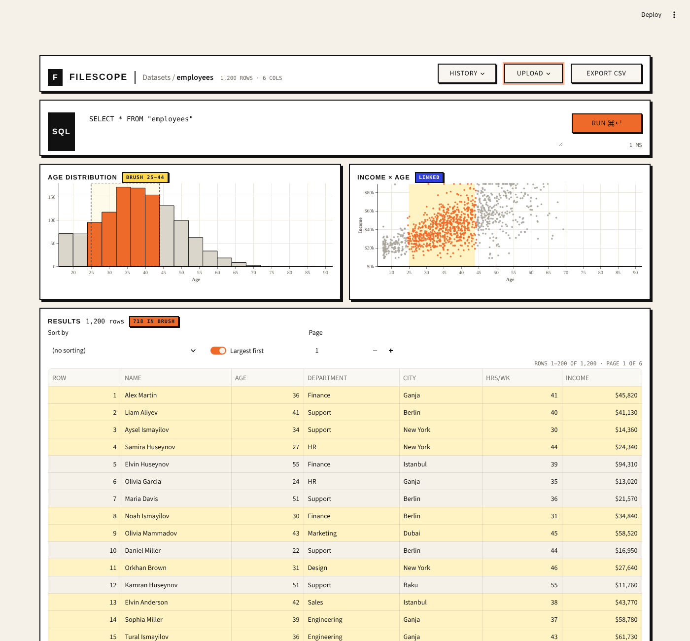

# FileScope — data explorer in Python

A web app for exploring your own data. Upload a CSV or Parquet file, then explore it
with SQL, a brushable age histogram, a linked income × age scatter plot and a
paged results table.

Built with **Python**, **Streamlit** (the web page), **DuckDB** (the database) and
**Altair** (the charts).



## How to run it

You need Python 3.10 or newer.

```bash
# 1. Download the project
git clone https://github.com/YOUR-USERNAME/filescope.git
cd filescope

# 2. Create a virtual environment and turn it on
python3 -m venv .venv
source .venv/bin/activate       # Mac / Linux
.venv\Scripts\activate          # Windows

# 3. Install the libraries
pip install -r requirements.txt

# 4. Start the app
streamlit run app.py
```

The app opens at http://localhost:8501.

## How to use it

- Click **UPLOAD** and choose a CSV or Parquet file.
- Type SQL in the box and press **RUN** (or **Ctrl+Enter** / **Cmd+Enter**).
  If the SQL has a mistake, the error appears in red and the old results stay.
- **Drag across the age histogram** to select an age range. The orange badge,
  the scatter plot and the table highlights all update. Click an empty part of the
  chart to clear the selection.
- Use **Sort by** and **Page** above the table to sort and move through the rows.
- **HISTORY** shows your last 20 queries. **EXPORT CSV** downloads the full result
  of the current query.
- The charts need columns named `age` and `income`; the table and SQL work with any columns.

## How it works

1. An uploaded file is saved and loaded into DuckDB as a table with `read_csv_auto`
   or `read_parquet`. Until then, the page shows only a "Start here" box.
2. The SQL you run becomes the **base query**. Every other query wraps it:
   `SELECT ... FROM (your query) AS q`.
3. The histogram counts people per 4-year age group in SQL. The scatter plot uses a
   2,000-row random sample. The table asks DuckDB for just 200 rows at a time
   (`LIMIT 200 OFFSET ...`), so a big file is never loaded into Python all at once.
4. The brush does not filter the table. It only highlights rows and counts how
   many are inside it (`WHERE age BETWEEN low AND high`).

## Files

| File | What it does |
| --- | --- |
| `app.py` | The web page: header, SQL bar, charts and table |
| `data.py` | Every database query (DuckDB) |
| `charts.py` | The two Altair charts and the brush logic |
| `style.css` | The neo-brutalist look (borders, shadows, fonts) |
| `.streamlit/config.toml` | Page colors |
| `requirements.txt` | The libraries to install |
